# Database schema (draft)

This schema is a **backend-first blueprint** derived from the current frontend state (Zustand stores and pages) so you can start backend work with a clear data model.

- Target DB: **PostgreSQL**
- DDL file: `docs/database/schema.postgres.sql`
- Date: 2026-04-20

## Key assumptions

1. **Single association / tenant** (no `organizations` table). If you later want multi-tenant support, we can add an `organizations` table and add `organization_id` FKs.
2. **One primary role per user** (matches the current UI role model).
3. **Members are the canonical people records**; `users` are login accounts optionally linked to members.
4. **Money is stored as integer RWF** (e.g. `amount_rwf = 3500`).
5. Deletion is not modeled as soft-delete yet; you can add `deleted_at` columns later if needed.

## Frontend → DB mapping

- `frontend/src/data/eventsStore.ts`
  - `events`, `event_occurrences`, `event_attendance`, `event_materials`
- `frontend/src/data/financeStore.ts`
  - `funds`, `finance_transactions`, `budgets`
- `frontend/src/data/minutesStore.ts`
  - `minutes`, `minute_participants`, `minute_agenda_items`, `minute_resolutions`, `minute_action_items`
  - `documents`, `document_versions`, `document_tags`
- `frontend/src/data/devotionStore.ts`
  - `devotions`, `devotion_prayer_points`, `devotion_comments`, `devotion_reactions`
- `frontend/src/data/prayerStore.ts`
  - `prayer_requests`, `counseling_requests`, `testimonies`
- `frontend/src/data/welfareStore.ts`
  - `welfare_cases`, `welfare_case_notes`, `welfare_visits`, `welfare_visit_assignees`, `welfare_visit_attendees`
- `frontend/src/data/requestsStore.ts`
  - `association_requests`
- `frontend/src/data/leadershipStore.ts`
  - `leadership_terms`, `committees`, `committee_members`, `handover_notes`
- `frontend/src/data/alumniStore.ts`
  - `alumni_profiles` (attached to `members`)
- `frontend/src/data/mock.ts`
  - `members`, `announcements` (now proper tables)

## ER diagram (high-level)

```mermaid
erDiagram
  MEMBERS ||--o| USERS : "linked account"
  MEMBERS ||--o| ALUMNI_PROFILES : "optional"

  USERS ||--o{ ANNOUNCEMENTS : authors

  EVENTS ||--o{ EVENT_OCCURRENCES : has
  EVENT_OCCURRENCES ||--o{ EVENT_ATTENDANCE : records
  MEMBERS ||--o{ EVENT_ATTENDANCE : attends
  EVENTS ||--o{ EVENT_MATERIALS : uploads

  FUNDS ||--o{ FINANCE_TRANSACTIONS : groups
  MEMBERS ||--o{ FINANCE_TRANSACTIONS : "payer (optional)"
  FUNDS ||--o{ BUDGETS : planned

  MINUTES ||--o{ MINUTE_PARTICIPANTS : has
  MEMBERS ||--o{ MINUTE_PARTICIPANTS : participates
  MINUTES ||--o{ MINUTE_AGENDA_ITEMS : has
  MINUTES ||--o{ MINUTE_RESOLUTIONS : has
  MINUTES ||--o{ MINUTE_ACTION_ITEMS : has

  DOCUMENTS ||--o{ DOCUMENT_VERSIONS : has
  DOCUMENTS ||--o{ DOCUMENT_TAGS : tagged

  DEVOTIONS ||--o{ DEVOTION_PRAYER_POINTS : has
  DEVOTIONS ||--o{ DEVOTION_COMMENTS : has
  DEVOTIONS ||--o{ DEVOTION_REACTIONS : has
  USERS ||--o{ DEVOTION_COMMENTS : writes
  USERS ||--o{ DEVOTION_REACTIONS : reacts

  MEMBERS ||--o{ WELFARE_CASES : affects
  WELFARE_CASES ||--o{ WELFARE_CASE_NOTES : has
  MEMBERS ||--o{ WELFARE_VISITS : "visited"
  WELFARE_VISITS ||--o{ WELFARE_VISIT_ASSIGNEES : plans
  WELFARE_VISITS ||--o{ WELFARE_VISIT_ATTENDEES : records
  MEMBERS ||--o{ WELFARE_VISIT_ASSIGNEES : assigned
  MEMBERS ||--o{ WELFARE_VISIT_ATTENDEES : attended

  USERS ||--o{ ASSOCIATION_REQUESTS : submits
```

## What to decide before backend implementation

1. **Auth style**: email/password vs OTP vs external provider. (This affects whether `users.password_hash` is required.)
2. **Member vs user lifecycle**: do all members get accounts, or only leaders? If all members get accounts, enforce `users.member_id NOT NULL`.
3. **Alumni modeling**: current schema treats alumni as a profile on a member. If you want alumni outside the member list, we can split into a separate `alumni` table.
